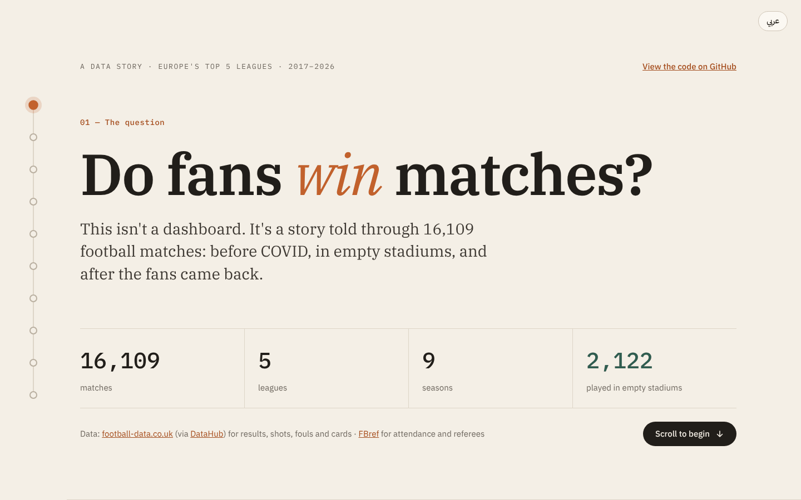
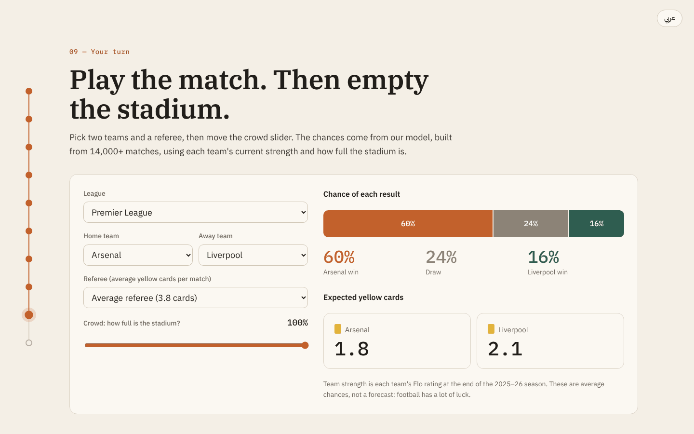

# Do Fans Win Matches?

**How much of football's home advantage comes from the crowd? An interactive data story built on 16,109 matches from Europe's top 5 leagues.**

🔗 **Live site:** [football-crowd-analysis.vercel.app](https://football-crowd-analysis.vercel.app/) · English & العربية · works on mobile


## Project Report
https://docs.google.com/document/d/1L6aRbKV3qxD4tNKn_YfCEnrFfW4qbxAbhtWNRdLjGE8/edit?usp=sharing

## The idea

Home teams win more often than away teams. Everyone agrees on that. What nobody can easily test is *why*: is it the crowd, the travel, the familiar pitch, or the referee?

COVID-19 gave football an accidental experiment. Between 2020 and 2021, more than 2,000 top-flight matches were played in empty stadiums: the same teams, the same referees, the same rules, and no fans. This project uses those ghost games to measure what the crowd actually changes.

## What the data shows

| | Home win | Draw | Away win |
|---|---|---|---|
| Before COVID (2017–2020) | 45.0% | 25.0% | 30.0% |
| Empty stadiums | 39.9% | 25.3% | 34.8% |
| Fans back (2022–2026) | 43.8% | 25.3% | 31.0% |

- **Home advantage shrank by about two thirds without fans.** The gap between home and away wins fell from 15 points to 5, then came back when the crowds returned.
- **Referees changed the most.** With fans, away teams got 0.27 more yellow cards per match than home teams. Without fans, the gap was zero.
- **Players changed too.** The home team's shot advantage halved (2.6 → 1.35 per match), and shots aren't decided by the referee.
- **Any crowd is enough.** The big jump is from no fans to some fans, not from a half-full stadium to a full one.
- **It's not the same everywhere.** Home wins dropped most in Ligue 1 and the Premier League, and not at all in Serie A.

These results agree with published research on the same period, for example [McCarrick et al. (2021)](https://doi.org/10.1016/j.psychsport.2021.102013).

## What you can do on the site

- Follow the story section by section: attendance over time, results, referees, players and crowd size
- Filter every chart by league
- **Your team:** compare any club's home record with fans and in empty stadiums
- **Match simulator:** pick two teams, a referee and how full the stadium is, and see the chance of each result and the expected yellow cards



## Data

| Source | What it provides |
|---|---|
| [football-data.co.uk](https://www.football-data.co.uk), through [DataHub](https://datahub.io/football) | Results, shots, fouls and cards |
| [FBref](https://fbref.com) | Attendance, stadium and referee |

**Scope:** Premier League, La Liga, Serie A, Bundesliga and Ligue 1, seasons 2017–18 to 2025–26 (16,109 matches).

**How the data was checked:**
- The scores and dates of every match agree between the two independent sources.
- The final league table of all 45 seasons, rebuilt from the data, matches the official champions, points and bottom teams.
- Premier League referees agree between the two sources in 3,411 of 3,420 matches.

## Method

1. **Collect** both sources for every league and season.
2. **Clean and merge:** match team names between the sites, remove cancelled and play-off matches, and label every match as a normal crowd, a limited COVID crowd, a ghost game, or unknown.
3. **Explore:** compare results, cards, fouls and shots with and without fans, by league and by how full the stadium was.
4. **Model** (using only information known before kick-off):
   - **Match result:** Logistic Regression on team strength (Elo rating) and stadium fill. 52.5% accuracy, against 43.3% for always picking the home team.
   - **Yellow cards:** Linear Regression on referee strictness and stadium fill.
5. **Export** the chart data and model coefficients to JSON. The website runs the models in the browser, so it needs no server.

## Project structure

```
data/clean/          matches.csv (cleaned dataset), model_export.json
data/raw/            original downloads (not committed)
notebooks/
  01_collect.ipynb   download DataHub files, read saved FBref pages
  02_clean.ipynb     merge sources, fix team names, classify crowds, build features
  03_eda.ipynb       structure, missing values, univariate and bivariate analysis
  04_model.ipynb     Elo ratings, result model, cards model
  05_export.ipynb    export chart data and the model for the website
report/figures/      charts and website screenshots
web/                 React website (Vite + Recharts)
```

## Run it yourself

**Notebooks** (Python 3.10+):
```bash
python -m venv .venv
.venv\Scripts\activate            # Mac/Linux: source .venv/bin/activate
pip install -r requirements.txt
```
Run the notebooks in order, 01 to 05. FBref blocks automated downloads, so its "Scores & Fixtures" pages are saved from the browser into `data/raw/` (Ctrl+S → "Webpage, HTML Only"). `01_collect` lists the exact pages and file names.

You can also skip straight to `03_eda`: the cleaned dataset `data/clean/matches.csv` is included.

**Website** (Node.js 18+):
```bash
cd web
npm install
npm run dev        # open the link it prints (usually http://localhost:5173)
```

**Deploy:** the site is static. On Vercel, import the repo and set the Root Directory to `web`. On Netlify, use base directory `web`, build command `npm run build` and publish directory `web/dist`.

## Limitations

- Ghost games happened during COVID, when other things changed too (crowded fixture lists, five substitutes).
- The crowd effect is an average across all teams. Each team has too few ghost games to measure its own.
- Stadium capacity is estimated from each venue's biggest normal crowd, not official figures.
- Some 2021–22 matches with no recorded attendance were real ghost games, but they're excluded because they can't be told apart from missing data.
- FBref has a few attendance typos: 7 matches outside COVID show under 3,000 fans (e.g. 13 at Getafe). That's 0.04% of the data, and removing them doesn't change any result.
- The result model never picks a draw as the single most likely outcome, which is normal for football models.

## Credits

- Data: [football-data.co.uk](https://www.football-data.co.uk) via [DataHub](https://datahub.io/football), and [FBref](https://fbref.com)
- Photo of Camp Nou: [Jordiferrer](https://commons.wikimedia.org/wiki/File:Lliga_2010-11_Festa_al_Camp_Nou_-_divendres.JPG), CC BY-SA 3.0, via Wikimedia Commons
- Built with pandas, Matplotlib, seaborn, scikit-learn, React and Recharts

Made by **Ahmed Alluqmani**, originally as the Unit 3 final project at Tuwaiq Academy.
